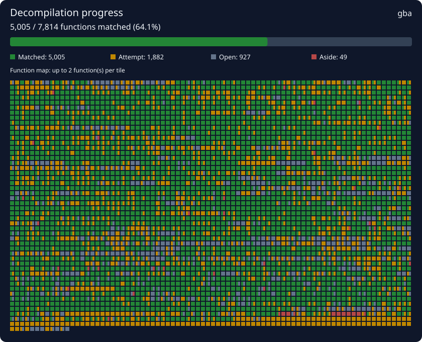

# Breath of Fire decompilation

A matching Game Boy Advance decompilation in [decompdecomp](https://github.com/n-delic/decompdecomp).
AI agents contributed C attempts. A function counts as matched when the compiled bytes match the original.

<!-- decompdecomp:details:start -->
- **Game:** Breath of Fire
- **Platform:** gba
- **Compiler:** agbcc
<!-- decompdecomp:details:end -->
<!-- decompdecomp:progress:start -->
- **Progress:** 4985 matching function(s), 1899 best attempt(s)
- **Completion:** 4,985 / 7,814 functions (63.8%). 49 set aside, excluded from completion.
<!-- decompdecomp:progress:end -->

## Continue the decompilation

1. Install [decompdecomp](https://github.com/n-delic/decompdecomp/releases/latest) and set up `agbcc` in **Compilers & tools**. On Windows, the GBA compiler runs through WSL 2.
2. Clone this repository with `git clone https://github.com/Adeelshah001/bof1-Decomp.git`.
3. In decompdecomp, choose **New project → Open a saved project**. Select the cloned repository root and your own dump of Breath of Fire (USA).

The expected cartridge code is `ABFE` and the dump is 4,194,304 bytes.
Its SHA-1 is `b30533f68037b47d5439bab0182169e4a643a38d`. decompdecomp checks the dump and rejudges saved functions on import.

## Project files

- `src/` holds matching C, `best/` holds the best attempts so far, and `include/` holds the shared header.
- `decompdecomp.json` records the dump fingerprint, function layout, names, compiler settings, and research notes.

Keep ROMs, save files, extracted assets, and generated disassembly local. Commit saved C, headers, and metadata
from the repository root after decompdecomp judges your changes.

The map updates when decompdecomp saves. Green means matched, gold means attempted, grey means open, and red means
set aside. Keep project notes outside the tagged blocks so the app preserves them.

Generated progress map

<!-- decompdecomp:visuals:start -->

<!-- decompdecomp:visuals:end -->

